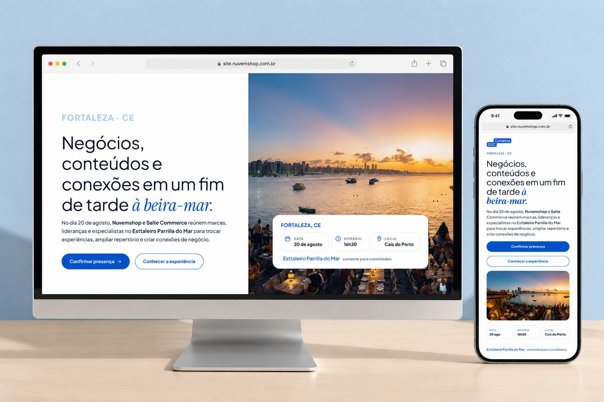
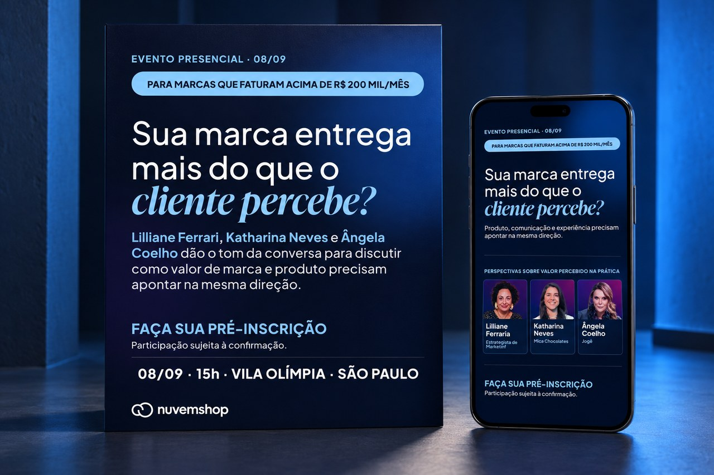
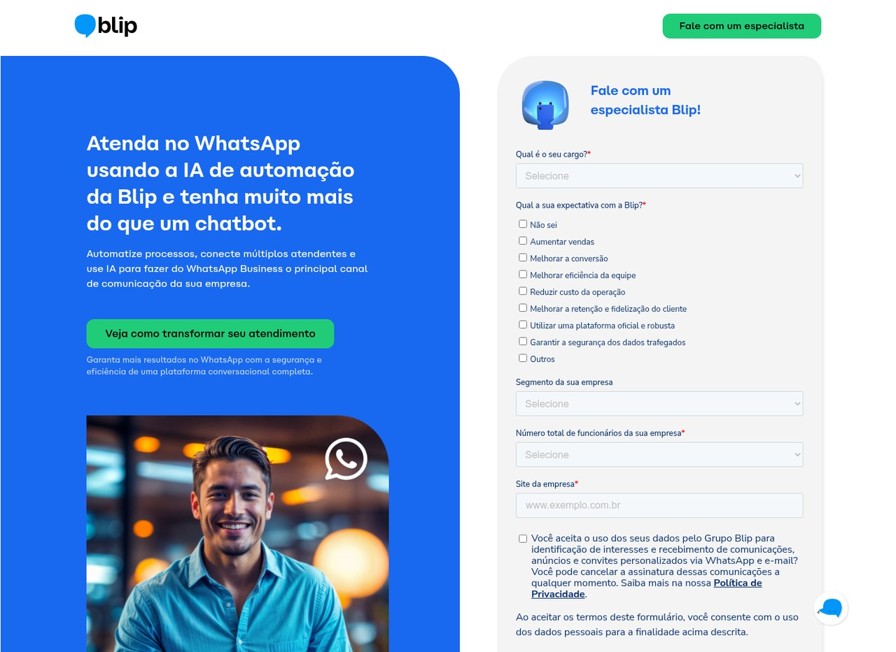

# Fernando Fidelis

**Web designer working across brand, marketing and CRO.**

I design and build marketing websites, landing pages and campaign assets. My work connects visual identity, clear content, responsive layouts and conversion, from the brief to implementation and iteration.

[Portfolio index](portfolio/README.md) | [Behance](https://www.behance.net/ffideliz) | [LinkedIn](https://www.linkedin.com/in/fernando-fidelis/)

## Selected design work

| PicPay: A Black Fica Verde | Conecta D2C |
|---|---|
|  |  |
| Strategy, concept, copy, art direction and motion. A hiring case revisited for portfolio, without a live campaign or measured results. | Event pages and communication journeys, working within Nuvemshop's identity. |

| Nuvemshop Next | Blip: Web & CRO |
|---|---|
|  |  |
| B2B event landing pages, campaign assets, responsive design and implementation. | Six years with websites, acquisition pages and continuous experimentation. |

Also selected: [Me Escuta: product-page design](portfolio/me-escuta/README.md) and [Inhotim Store: e-commerce](portfolio/inhotim/README.md).

## Background

- 11+ years across web design, branding, marketing, CRO and digital strategy.
- Six years at Blip, including co-leading the rebuild of the web ecosystem in three languages.
- In 2025, the corporate website's conversion page reached a conversion rate above 16%, with an approximate 170% increase through continuous tests, adjustments, SEO and applied learning.
- Current work includes Nuvemshop Next and Conecta D2C projects, fractional CMO work at Me Escuta, and design and marketing consulting.
- CXL certifications in CRO, Brand Strategy, Marketing Strategy and Sales Copywriting.
- Advertising and Marketing graduate from UFMG.

## AI, automation and technical projects

### [Vera Open](https://github.com/veralifeos/vera-open)

Open-source AI life operating system that reads Notion, prioritizes work, monitors signals and delivers daily briefings through Telegram.

[Website](https://getvera.dev) | [Release](https://github.com/veralifeos/vera-open/releases/tag/v0.5.0)

### [CRO Exercise: ClassPass](https://github.com/ffidelis16/CRO-Exercise-ClassPass)

A responsive three-page conversion funnel with accessibility, experimentation hooks and analytics-ready instrumentation.

[Live demo](https://ffidelis-cro-pickleball.netlify.app) | [Release](https://github.com/ffidelis16/CRO-Exercise-ClassPass/releases/tag/v1.0.0)

### [Pool Championship Manager](https://github.com/ffidelis16/pool-championship-manager)

Single-page tournament manager with match scheduling, standings, playoffs, organizer mode and Firebase synchronization.

[Release](https://github.com/ffidelis16/pool-championship-manager/releases/tag/v1.0.0)

## Toolkit

Figma, Adobe Creative Cloud, WordPress, HubSpot, HTML/CSS/JavaScript, GA4, GTM, Microsoft Clarity, Python, APIs, Make, n8n and AI workflows.

## Contact

[LinkedIn](https://www.linkedin.com/in/fernando-fidelis/) | [Behance](https://www.behance.net/ffideliz) | [Vera](https://getvera.dev) | [Email](mailto:ffideliz@yahoo.com.br)
