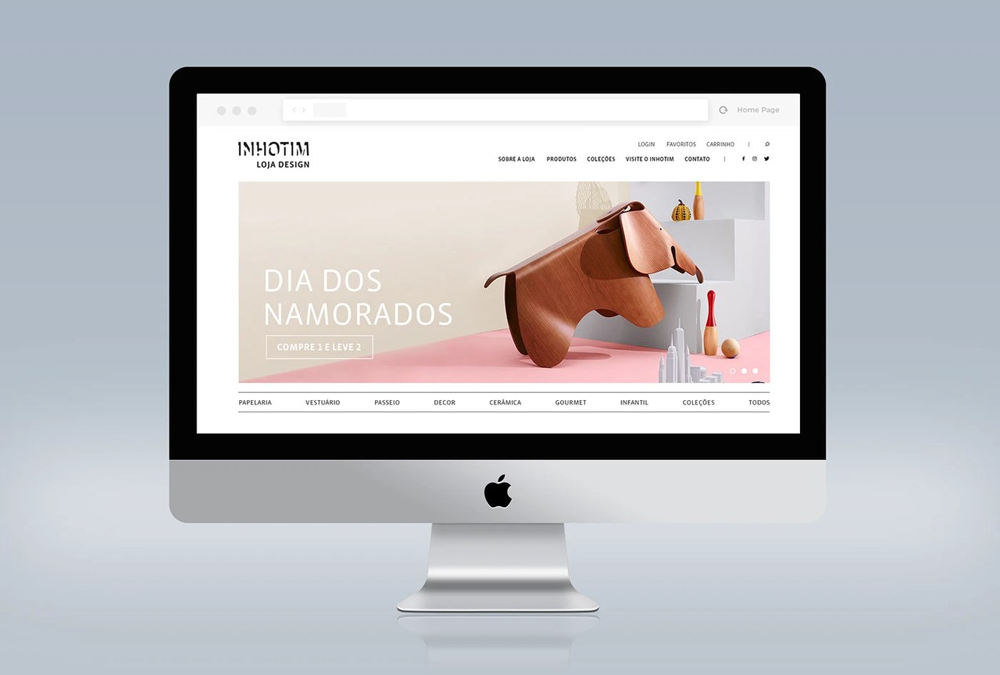

# Inhotim Store: design de e-commerce

Design de website para a loja do Inhotim, desenvolvido na KOMUH. O projeto organiza produtos, fotografia e conteúdo editorial numa interface de varejo.

**Meu papel:** design da interface, apresentação dos produtos e composição das páginas.

## Apresentação e case original

- [Apresentação em PDF](apresentacao.pdf)
- [Case original publicado no Behance](https://www.behance.net/gallery/76881961/Inhotim-Store-Website)

Trabalho de agência apresentado como registro de portfólio. Não é uma afirmação sobre a versão atual do site ou sobre resultado de conversão.

## Project summary

E-commerce website design developed at KOMUH, focused on product presentation, page composition and the store's editorial identity.

[Voltar ao portfólio](../README.md) · [Perfil](../../README.md) · [LinkedIn](https://www.linkedin.com/in/fernando-fidelis/)
