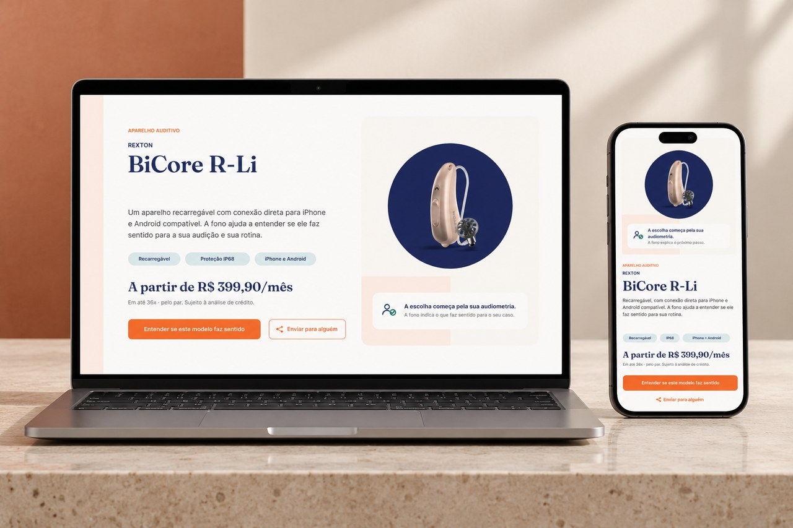

# Me Escuta: interface de produto e jornada de decisão

Atuo como CMO fractional na Me Escuta, com trabalho direto em design, conteúdo e jornada digital. Este recorte mostra o projeto de uma página de produto: apresentação do aparelho, informações para comparação e um próximo passo orientado pela conversa com a equipe.

## O que observar

- Nome, imagem e recursos como primeira camada de leitura.
- Hierarquia de informação adaptada ao mobile.
- Ação principal voltada a entender a adequação do modelo.
- Explicação das etapas antes da decisão.

## Apresentação

- [Apresentação em PDF](apresentacao.pdf)
- [Site público da Me Escuta](https://meescuta.com/)

Os layouts do PDF são protótipos em Figma. O link do site é uma referência da empresa e não comprova que esta página de produto específica esteja publicada. Valores dentro dos layouts pertencem ao material de referência.

## Project summary

A product-page prototype connecting product information with a clear next step: a conversation about suitability. As fractional CMO, I work across design, messaging and the digital journey. The layouts shown here are Figma prototypes.

[Voltar ao portfólio](../README.md) · [Perfil](../../README.md) · [LinkedIn](https://www.linkedin.com/in/fernando-fidelis/)
